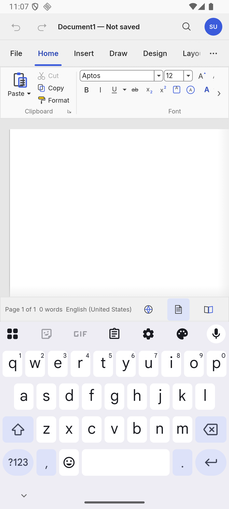
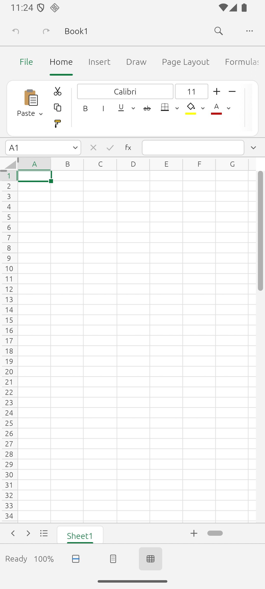
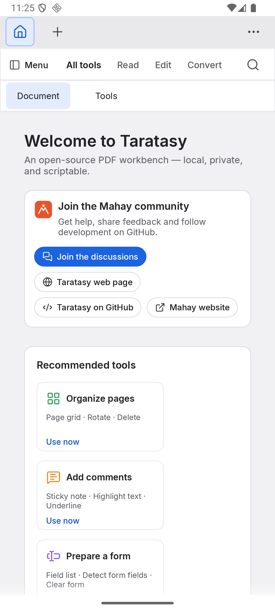

<p align="center">
  
</p>

<h3 align="center">Fourteen creative and office apps. Free, native, private.<br>One download. Linux, Android phones and tablets.</h3>

<p align="center">
  <a href="https://github.com/raantss18/mahay/releases/latest"></a>
  
  
  
  <a href="LICENSE-MIT"></a>
</p>

<p align="center">
  <b>English</b> · <a href="README.fr.md">Français</a> · <a href="README.mg.md">Malagasy</a>
  &nbsp;|&nbsp;
  <a href="https://github.com/raantss18/mahay/releases/latest">Download</a> ·
  <a href="#system-requirements">Requirements</a> ·
  <a href="#the-apps">The apps</a> ·
  <a href="docs/STATUS.md">Status</a> ·
  <a href="CHANGELOG.md">Changelog</a>
</p>

---

**Mahay** (Malagasy: *skilled, able*) is a suite of **14 apps** to write, calculate, present, draw,
edit photos, audio and video, lay out pages and design interfaces. Every app is **native Rust**:
no Electron, no WebView, no account, no telemetry. Your files stay on your device, everything works
offline, and each app is small enough to install on its own.

Mahay is a fork of the [ArtCraft](https://github.com/storytold) crafting apps, renamed and ported
to **Android phones and tablets** and **Linux**. See [NOTICE](NOTICE).

> **Status: alpha (0.2).** The apps work and are tested on Android and Linux, but expect rough
> edges, especially on phones. [docs/STATUS.md](docs/STATUS.md) lists what works, what doesn't and
> what was tested on which device.

## Why Mahay

|   |   |
|---|---|
| 🔒 **Private by design** | No account, no telemetry, no cloud required. Documents open from, and save back to, wherever you keep them. |
| ⚡ **Native and light** | One APK per app, from about 5 MB (Mahay HUB) to about 25 MB. No browser engine inside. |
| 📴 **Offline first** | Everything works without a connection. The network is used only to check for updates. |
| 🔄 **Always up to date** | Signed updates (Ed25519 + SHA-256), checked daily, installed with one tap. |
| 📱 **Made for touch** | The layout follows the window width, with no setting: phone, tablet, split screen, desktop. |
| 🧰 **Opens your files** | DOCX, XLSX, PPTX, PDF, PSD, SVG, DXF and more, from Files, Drive or an e-mail. |

## The apps

<p align="center"></p>

| App | What it does | Linux | Android |
|-----|--------------|:-----:|:-------:|
| **Mahay HUB** | the hub: installs, opens and updates every app | ✅ | ✅ |
| **Soratra** | word processor (DOCX, ODT) | ✅ | alpha |
| **Tabilao** | spreadsheet (XLSX, ODS, CSV) | ✅ | alpha |
| **Seho** | presentations (PPTX) | ✅ | alpha |
| **Taratasy** | PDF: read, annotate, fill, sign, organise | ✅ | alpha |
| **Sary** | image editor (layers, PSD, raw) | ✅ | alpha |
| **Hazavana** | photo library and raw development | ✅ | alpha |
| **Tsilo** | vector illustration | ✅ | alpha |
| **Pejy** | page layout and publishing | ✅ | alpha |
| **Endrika** | interface design and prototyping | ✅ | alpha |
| **Drafitra** | technical drawing (CAD) | ✅ | alpha |
| **Feo** | recording, editing and mixing audio | ✅ | alpha |
| **Hetsika** | video editing | ✅ | alpha |
| **Tselatra** | motion graphics and visual effects | ✅ | alpha |

### On a phone

The ribbon apps turn into a touch layout on narrow windows: scrolling tabs and command bars, side
panels as drawers, nothing overlapping or leaving the screen. It is picked from the window width
alone, so rotating the phone or opening split screen changes it by itself. Soratra, Tabilao, Seho
and Taratasy have it so far (in development for 0.2.3); the other apps follow.

<table align="center">
  <tr>
    <td align="center"><br><sub><b>Soratra</b>: word processor</sub></td>
    <td align="center"><br><sub><b>Tabilao</b>: spreadsheet</sub></td>
    <td align="center"><br><sub><b>Taratasy</b>: PDF</sub></td>
  </tr>
</table>

## Install: just Mahay HUB

1. Download **Mahay HUB** from the [latest release](https://github.com/raantss18/mahay/releases/latest):
   `hub-…-android-arm64-v8a.apk` for Android phones and tablets (the right file for almost every
   device), `hub-…-linux-x86_64.AppImage` for Linux.
2. Open it. On Android, allow Mahay HUB to install apps when Android asks.
3. Tap **Install** on the apps you want. **Mahay HUB installs, opens and updates every other app**,
   straight from the release. Each app also updates itself.

Android may show a "Play Protect" warning for apps installed outside the Play Store: choose
*Scan* or *Install anyway*. Every file is signed and its fingerprint is in `SHA256SUMS.txt`.

## System requirements

| | **Android** | **Linux** |
|---|---|---|
| **System** | Android 8.0 (API 26) or newer, phone or tablet | 64-bit (x86_64) distribution with glibc 2.39 or newer: Ubuntu 24.04, Debian 13, Fedora 40, Arch and newer |
| **Processor** | 64-bit ARM (`arm64-v8a`), most phones and tablets since 2017. `x86_64` builds are for emulators, Chromebooks and Android on PC | x86_64 |
| **Graphics** | A GPU with OpenGL ES (Vulkan where available) | A GPU driver with Vulkan or OpenGL |
| **Storage** | About 5 MB for Mahay HUB, up to about 25 MB per app, plus your documents | About the same per app (AppImage) |
| **Memory** | Not measured yet: more is better for Sary, Hazavana, Hetsika and Tselatra (large images and video) | same |
| **Network** | Not needed. Only to download Mahay HUB and updates | same |
| **Other** | Allow "install unknown apps" for Mahay HUB | AppImage needs FUSE 2 (`libfuse2`), or run it with `--appimage-extract-and-run` |

Tested so far: Android 16 (API 36) on x86_64 emulators (a 1080×2400 phone and a 2560×1600 tablet)
and Linux x86_64. The arm64 APKs are built and signed but have not been run on a real device yet:
[docs/STATUS.md](docs/STATUS.md) says exactly what was verified and what was not.

## Works with your files

Every app opens its own kind of file from anywhere on the device: tap a spreadsheet in Files,
Drive or an e-mail and choose **Tabilao**; a picture opens in **Sary** (or is imported into
**Hazavana**), a PDF in **Taratasy**, a document in **Soratra**, slides in **Seho**, an SVG in
**Tsilo**, audio in **Feo**, a video in **Hetsika**, a DXF/DWG drawing in **Drafitra**. "Share"
works too. Saving writes back to the file you opened.

## Always up to date

Mahay updates itself, like Tontolo: each app (and Mahay HUB for all of them) checks the latest
release when it starts and once a day, downloads it in the background, checks its signature
(Ed25519) and SHA-256, then offers **Install**. On Android you confirm with one tap; on Linux the
AppImage replaces itself and restarts. You can turn it off in **About**.

**On Android, Mahay HUB looks after the other apps.** Install Mahay HUB first, then your apps
from it: on Android 12+ it updates them for you, at start, every day and in the background,
without asking you to confirm each one. An app you installed some other way joins after one
confirmed update. Limits Android imposes: **the first install of each app always needs a tap**
(Mahay HUB's **Install all** queues them, one confirmation each); below Android 12 every update is
confirmed (the hub's notification says how many are waiting); an app that is open when it is
updated restarts, so the background update leaves open apps for later. Background updates use
Wi-Fi only, unless you switch on **Also on mobile data** in the hub's settings. Every app also
works and updates alone, without the hub.


## Build from source

```bash
# Linux desktop app (from its folder)
cd apps/tabilao && cargo run --release -p tabilao
```

```bash
# Android APKs (needs the Android SDK + NDK 28, rustup with the Android targets, cargo-ndk)
scripts/android-build.sh --abi arm64-v8a tabilao
```

Each app is its own Cargo workspace under `apps/`; shared code lives in `libs/core`. Details:
[docs/BUILDING.md](docs/BUILDING.md) · design decisions: [docs/DECISIONS.md](docs/DECISIONS.md) ·
porting notes: [docs/PORTING_AUDIT.md](docs/PORTING_AUDIT.md) · roadmap: [TODO.md](TODO.md).

## Security

Found a vulnerability? Please report it privately, as described in [SECURITY.md](SECURITY.md).
The audit notes are in [docs/SECURITY_AUDIT.md](docs/SECURITY_AUDIT.md).

## License

Dual-licensed under [MIT](LICENSE-MIT) or [Apache-2.0](LICENSE-APACHE), at your option
(`SPDX: MIT OR Apache-2.0`). Upstream copyright notices are kept in every imported tree.
Third-party licenses: [THIRD_PARTY_LICENSES.md](THIRD_PARTY_LICENSES.md).
