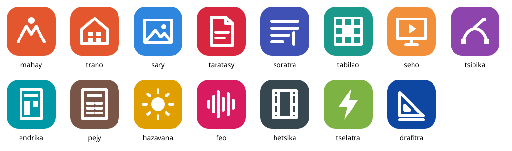

  

> **Fiteny / Language / Langue:** [English](README.md) · [Français](README.fr.md) · **Malagasy**

**Mahay** dia andiana rindranasa malalaka hamoronana sy hiasana amin'ny birao, ho an'ny
**Linux** sy ny **finday sy takelaka Android**. Samy nosoratana tamin'ny Rust avokoa izy ireo:
tsy misy Electron, tsy misy WebView, tsy mila kaonty, tsy misy fanaraha-maso. Mijanona ao
amin'ny fitaovanao ny rakitrao.

Mahay dia fork an'ireo rindranasa [ArtCraft](https://github.com/storytold), novana anarana ary
nampandehanina tamin'ny Android. Jereo ny [NOTICE](NOTICE).

> **Toerana: alpha (0.1).** Mandeha ireo rindranasa, saingy mbola misy tsy fahatanterahana,
> indrindra amin'ny finday. Jereo ny [docs/STATUS.md](docs/STATUS.md).

## Ireo rindranasa

| Rindranasa   | Asany                                               | Linux | Android |
|--------------|-----------------------------------------------------|-------|---------|
| **Trano**    | ny fandraisana: mampiseho sy manokatra ny rindranasa | eny   | eny     |
| **Sary**     | fanamboarana sary (sosona, PSD, RAW)                | eny   | alpha   |
| **Taratasy** | PDF: vakiana, asiana fanamarihana, fenoina, soniavina | eny | alpha   |
| **Soratra**  | fanoratana lahatsoratra (DOCX, ODT)                 | eny   | alpha   |
| **Tabilao**  | tabilao kajy (XLSX, ODS, CSV)                       | eny   | alpha   |
| **Seho**     | fampisehoana (PPTX)                                 | eny   | alpha   |

Mbola ho avy ny valo hafa: Tsipika, Endrika, Pejy, Hazavana, Feo, Hetsika, Tselatra, Drafitra.

## Fametrahana

**Android 8.0 na vaovao kokoa.** Alaivo ny APK ao amin'ny
[dikan-teny farany](https://github.com/raantss18/mahay/releases/latest): `arm64-v8a` ho an'ny
finday sy takelaka, `x86_64` ho an'ny emulateur. Ny rindranasa ilainao ihany no apetraho; Trano
no manokatra azy ireo.

**Linux** (x86_64): alaivo ny `.AppImage`, ataovy azo alefa, dia alefaso.

## Maivana

- APK iray isaky ny rindranasa: izay ampiasainao ihany no alainao (5 hatramin'ny 23 Mo).
- Kaody teratany, tsy misy motera mpitety tranonkala ao anatiny.
- Mandeha tsy mila aterineto. Misokatra sy voatahiry any amin'ny toerana itahirizanao azy ny
  antontan-taratasy (Fichiers, Drive, kapila USB).

## Fahazoan-dalana

[MIT](LICENSE-MIT) na [Apache-2.0](LICENSE-APACHE), araka ny safidinao. Voatahiry ny fanamarihana
copyright an'ny upstream.
