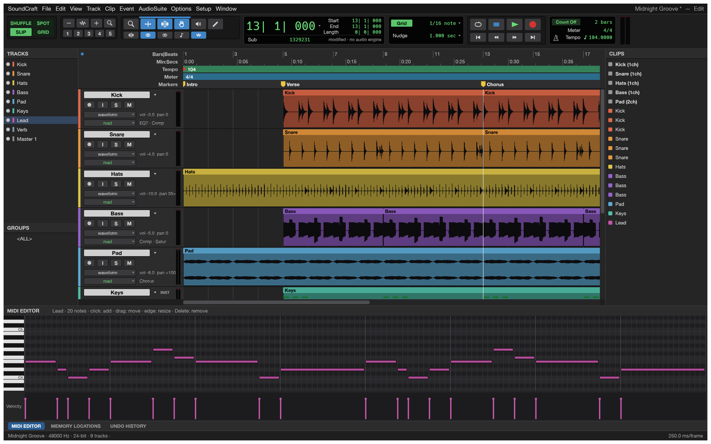
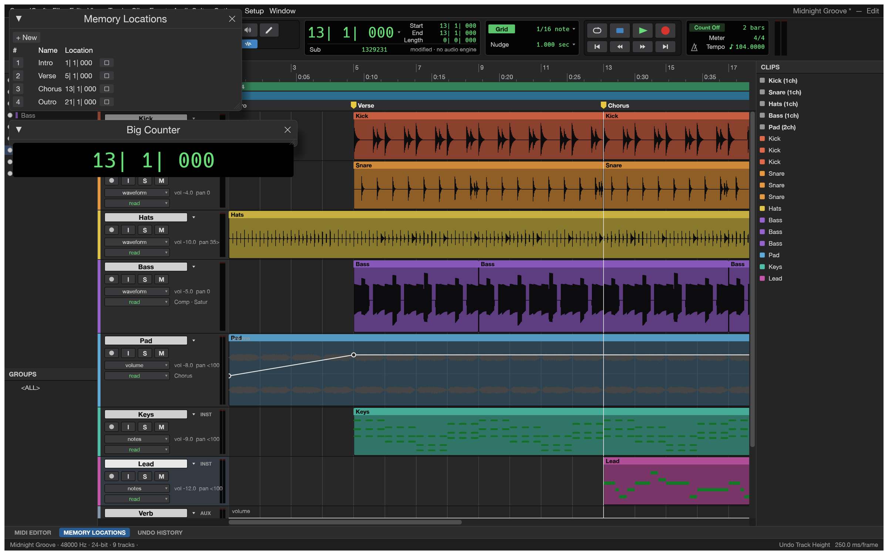
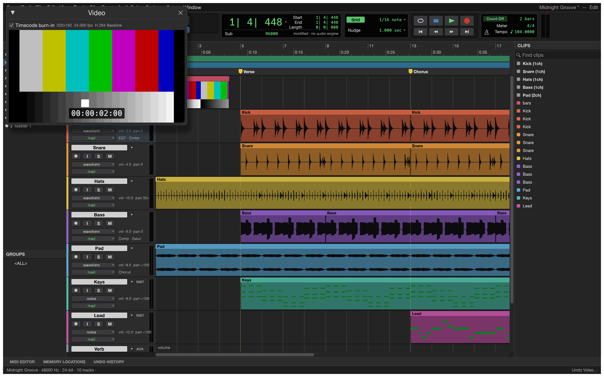
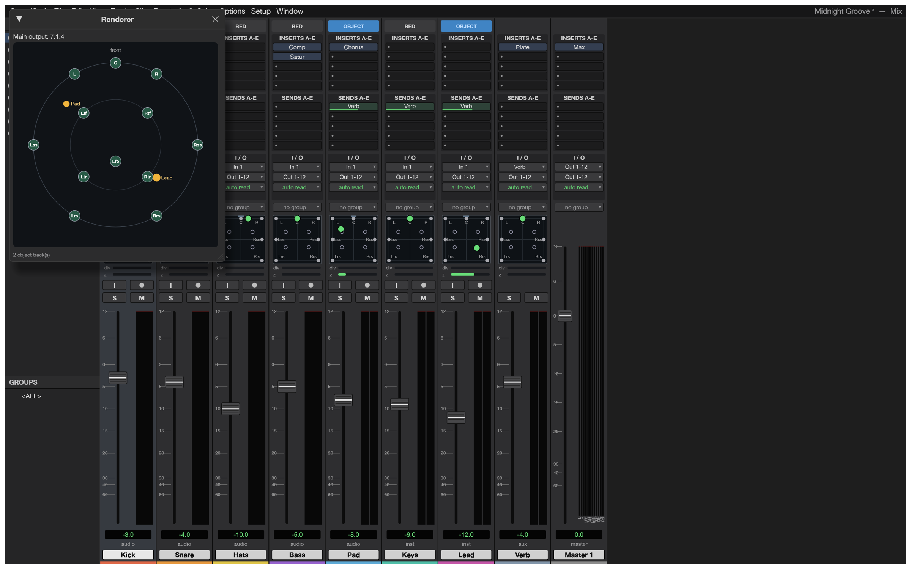
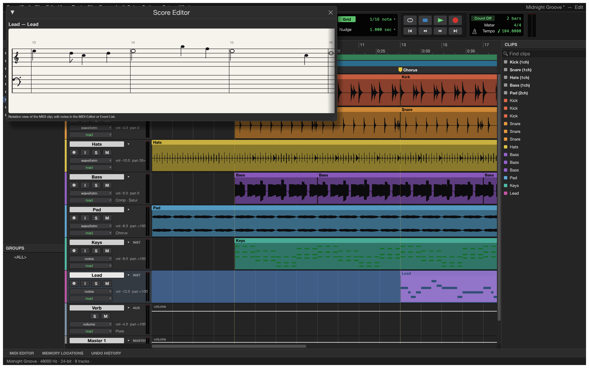

<p align="center">
  <a href="https://github.com/raantss18/mahay">
    <picture>
      <source media="(prefers-color-scheme: dark)" srcset="docs/brand/mahay-logo-white.svg">
      
    </picture>
  </a>
</p>

<h1 align="center">Feo</h1>

<p align="center">
  <b>Recording, editing and mixing audio; an open-source, modern digital audio workstation (DAW), built in pure Rust.</b>
</p>

<p align="center">
  A complete digital audio workstation that runs natively on macOS, Windows, Linux and FreeBSD, and
  in the browser. Multitrack editing, a full mixer with plugins, sends and automation, MIDI, recording
  and bouncing, and every action scriptable from the command line or by an AI agent.
</p>

<p align="center">
  
  
  
  
  
</p>

<p align="center">
  <a href="https://github.com/raantss18/mahay/discussions"></a>
</p>

<p align="center">
  <a href="https://github.com/raantss18/mahay"><b>Feo in Mahay HUB</b></a> ·
  <a href="https://github.com/raantss18/mahay">Mahay</a> ·
  <a href="https://github.com/raantss18/mahay">All Mahay apps</a>
</p>

<p align="center">
  
  <br>
  <sub>The Edit window: tracks, waveforms, MIDI, rulers, markers and the transport, playing the built-in demo song (every sound in it is synthesised by Feo itself).</sub>
</p>

> [!NOTE]
> **Mahay is a community of artists from all walks of life.** Painters, photographers,
> filmmakers, illustrators, designers, animators, hobbyists, and people who picked up a pencil
> last week. If you make things, you're one of us. **[Come say hi on Discord](https://github.com/raantss18/mahay/discussions).**

<p align="center">
  <a href="#what-it-does">What it does</a> ·
  <a href="#getting-started">Getting started</a> ·
  <a href="#for-agents-and-scripts">Agents &amp; scripts</a> ·
  <a href="#how-its-built">How it's built</a> ·
  <a href="#status-and-roadmap">Status</a> ·
  <a href="#downloads">Downloads</a> ·
  <a href="#the-crafting-apps">The Mahay apps</a> ·
  <a href="#license-and-credits">License</a>
</p>

## What it does

Feo follows the workflow audio engineers already know: an **Edit window** for arranging and
editing, a **Mix window** for balancing, edit modes, tools, playlists, memory locations, AudioSuite
processing and the rest. If you've spent years in that workflow, your hands should already know
where things are.

<table>
  <tr>
    <td width="50%"></td>
    <td width="50%"></td>
  </tr>
  <tr>
    <td><b>Mix window.</b> Ten inserts and ten sends per track, busses and aux inputs, master faders, VCAs, routing folders, solo-in-place with implicit solo, and meters with peak hold.</td>
    <td><b>MIDI editor.</b> Instrument tracks with built-in synths, a piano roll with a velocity lane, step input, quantize, transpose, and Standard MIDI File import and export.</td>
  </tr>
  <tr>
    <td width="50%"></td>
    <td width="50%"></td>
  </tr>
  <tr>
    <td><b>Automation and markers.</b> Breakpoint automation for volume, pan, mute, sends and every plugin parameter, written live in Write, Touch and Latch, plus memory locations and a big counter.</td>
    <td><b>Everywhere.</b> Signed builds for macOS (universal), Windows (x64, x86, Arm), Linux (AppImage, deb, rpm, Flatpak), FreeBSD, and a WebAssembly build that runs in the browser.</td>
  </tr>
  <tr>
    <td width="50%"></td>
    <td width="50%"></td>
  </tr>
  <tr>
    <td><b>Video.</b> A picture track with thumbnails and a Video window that follows the playhead, decoding H.264, ProRes and Motion JPEG in pure Rust, with timecode burn-in and sync offset.</td>
    <td><b>Surround and immersive.</b> Main and bus formats from stereo to 9.1.6 and Ambisonics, a surround panner with divergence and height, object/bed routing and a Renderer window with live speaker levels.</td>
  </tr>
  <tr>
    <td width="50%"></td>
    <td></td>
  </tr>
  <tr>
    <td><b>Notation.</b> A Score Editor for MIDI tracks, MusicXML export for Sibelius and other notation programs, and printable engraved scores.</td>
    <td><b>Your plugins too.</b> CLAP, VST3 and Audio Units, with their own editors, their state saved in the session, and every instance created off the audio thread.</td>
  </tr>
</table>

### Feature tour

- **Editing:** Shuffle, Slip, Spot and Grid modes; Smart, Selector, Grabber, Trim, Pencil, Zoom and
  Scrubber tools; cut, copy, paste, duplicate, repeat, shift, insert silence, separate (at
  selection, on grid, at transients), heal, consolidate, strip silence, nudge; fades and
  crossfades in five shapes, drawn straight from the clip corners; playlists with comping lanes;
  clip gain lines; edit groups; single-key Commands Focus shortcuts; trackpad scrolling that
  follows your fingers and pinch-to-zoom around the pointer; undo for everything.
- **Mixing:** fader and pan with automation, pre/post sends, busses, aux inputs, master faders,
  VCA masters, routing folders, solo modes, mute and solo groups, phase invert and trim, clip
  effects, and automatic plugin delay compensation.
- **Automation:** volume, pan, mute, send and every plugin parameter; Write, Touch, Latch and
  Trim passes recorded live from the faders; thin, glide, coalesce and convert to clip gain.
- **Plugins:** 7-band and 1-band EQ, compressor/limiter, expander/gate, de-esser, maximizer,
  channel strip, room and plate reverbs, mod delay, chorus, flanger, phaser, saturator, lo-fi,
  rectifier, pitch shifter, time shift, gain, trim, invert, DC removal, signal generator, dither,
  a subtractive synth, a drum synth and a sampler (plays any WAV, AIFF, FLAC, MP3 or OGG across the
  keyboard), all original. **CLAP plugins** load too. Any processor
  runs offline as AudioSuite, and user presets save per plugin.
- **MIDI:** instrument and MIDI tracks, a piano-roll MIDI editor with a velocity lane, an event
  list, a score view, step input, quantize, transpose, real-time properties, Standard MIDI Files,
  and Audio-to-MIDI from a sung or played melody.
- **Recording:** punch in on a selection or on the fly, pre/post-roll, loop recording with a
  playlist per take, input monitoring through the full channel strip, and autosave with recovery.
- **Time and tempo:** Bars|Beats, Min:Secs, Timecode (every rate, drop-frame included),
  Feet+Frames and Samples; tempo and meter maps with a tempo editor; linear, parabolic and
  S-curve tempo ramps; key signatures and detected chords; Beat Detective and Identify Beat;
  pitch-preserving Elastic warping.
- **Audio files:** WAV/BWF/RF64, AIFF/AIFC and FLAC in and out; MP3, Ogg Vorbis, AAC, ALAC, CAF
  and the audio of MP4/MOV movies in. Any sample rate and bit depth.
- **Bounce:** mix or stems to WAV, AIFF or FLAC at 16/24/32-bit float with dither and
  normalisation, reporting peak, true peak and integrated loudness (LUFS).
- **Fast:** a parallel mix engine, copy-on-write undo, and a UI that holds 120 frames per second
  with seventy-odd tracks playing.

## Getting started

Download a build from the [releases page](https://github.com/raantss18/mahay/releases), or build
from source with Rust 1.95 or later for the desktop/web UI (the core workspace's declared
minimum remains Rust 1.90):

```sh
git clone https://github.com/raantss18/mahay
cd feo
cargo run --release -p feo -- --demo     # opens the demo song
```

Linux needs the ALSA headers (`libasound2-dev` on Debian/Ubuntu, `alsa-lib-devel` on Fedora).

The web build:

```sh
cd apps/feo-web && trunk serve --release   # then open http://127.0.0.1:8080
```

Useful shortcuts: <kbd>Space</kbd> play/stop, <kbd>⌘</kbd><kbd>=</kbd> Mix/Edit,
<kbd>F1</kbd>–<kbd>F4</kbd> edit modes, <kbd>F5</kbd>–<kbd>F10</kbd> tools, <kbd>⌘</kbd><kbd>E</kbd>
separate, <kbd>⌘</kbd><kbd>D</kbd> duplicate, <kbd>Enter</kbd> new marker, <kbd>⌘</kbd><kbd>⇧</kbd><kbd>N</kbd>
new tracks. **Setup › Keyboard Shortcuts** lists them all.

### Logs

The desktop app writes its `log` records to standard error and to `logs/feo.log` in the
settings directory, beside `ui.json`, `Autosave/` and `Presets/` (Linux `~/.config/feo/logs/`,
or `$XDG_CONFIG_HOME/feo/logs/`; macOS `~/Library/Application Support/Feo/logs/`;
Windows `%APPDATA%\Feo\logs\`). A start from a desktop menu or the Dock has no terminal, so
this file is what to attach to a bug report: the engine's panic report, audio devices that failed to
open or broke, plugins that refused their stored state, CLAP plugins' own messages and files that
failed to open land there. Each launch moves the previous log to `feo.1.log` (and that one to
`feo.2.log`), so the log of a run that crashed survives the next start. The file stops
growing at 16 MiB. `--version` writes no file, and runs with `FEO_NO_PREFS` log to standard
error only.

| Variable | Effect |
|---|---|
| `RUST_LOG` | Log levels for standard error and the log file. Default: `info` for Feo's own crates, `warn` for everything else. env_logger-style directives replace that, e.g. `RUST_LOG=debug`, `RUST_LOG=warn,feo_mix=trace` or `RUST_LOG=info,wgpu_core=warn`; a directive ending in `*` covers every target starting with it (`feo*=debug`). |
| `FEO_NO_PREFS` | No preferences read or written and no log file (agents' test runs). |

The realtime audio thread never writes a record itself: the logger keeps the first one it logs
(without waiting or allocating), counts the rest, and the UI thread writes them. The logger is
`apps/feo/src/logging.rs`. The web app logs to the browser console instead.

## For agents and scripts

Everything you can click is also a command with an id and JSON parameters, and the same commands
are reachable from the menus, the keyboard, the command line, a JSON control channel and an
[MCP](https://modelcontextprotocol.io) server. Programmatic calls never open dialogs, and
`session.inspect` reports exactly what changed, so an agent can check its own work.

```sh
# Headless: load the demo, turn the kick down, add an EQ, bounce.
feo-cli run --demo \
  --cmd 'mix.volume={"track":"Kick","db":-6}' \
  --cmd 'mix.insert={"track":"Bass","plugin":"eq_7band"}' \
  --bounce mix.wav

# Drive the running app.
feo --demo --control 7801 &
feo-cli app --port 7801 transport.play
feo-cli app --port 7801 ui.screenshot '{"path":"shot.png"}'

# Give Claude a DAW.
claude mcp add feo -- feo-cli mcp --demo

# Or keep the agent to some folders (reads and writes are separate roots).
feo-cli mcp --automation-read-root DIR --automation-write-root DIR
```

See [`docs/control-protocol.md`](docs/control-protocol.md) and [`docs/mcp.md`](docs/mcp.md).
`feo-cli commands` lists every command.

Open **Feo › Session Audio Health** to check loaded audio availability, sample-rate
mismatches and clip source bounds across all playlists, including alternate takes. The report
offers a refresh button and suggests how to resolve each issue. Scripts can obtain the same JSON
report with `feo-cli run --demo --cmd 'session.audio_health={}'`. This checks loaded media,
not files on disk, signal levels, plugins or routing.

## How it's built

Feo is a Cargo workspace of small crates with strict layering: nothing below the UI knows
about egui, so the interface could be swapped for another one.

| Crate | What it does |
|---|---|
| `feo-time` | Timebases, tempo and meter maps, timecode, grid |
| `feo-audio-io` | Audio file formats and waveform overviews |
| `feo-midi` | Standard MIDI Files and MIDI operations |
| `feo-dsp` | Plugins, offline processing, meters, loudness, FFT |
| `feo-model` | The session document |
| `feo-mix` | The mix engine (realtime and offline share it) |
| `feo-engine` | Commands, undo, editing, import/export, bounce |
| `feo-playback` | Audio devices (CoreAudio, WASAPI, ALSA, WebAudio) and recording |
| `feo-automation` | MCP server and control-channel client |
| `feo-ui-egui` | The user interface |

The code never panics on bad input: errors are values, and a malformed file or a bad agent call
produces a message, never a crash. `cargo xtask ci` runs formatting, clippy, the tests, the asset
and layering checks and the WebAssembly build.

## Status and roadmap

Feo is **pre-alpha**: it covers 94 % of the incumbent's menu items (measured), about 70 % of
its features by presence, and is roughly 40 % of the way to replacing it for real work: record,
edit, mix and bounce work end to end, but choosing an audio interface and buffer size,
recording MIDI from a controller and session interchange (AAF/OMF) are still missing, and those
are the alpha checklist. Translations are missing too. The status, the stage and our effort
estimates are in [`ROADMAP.md`](ROADMAP.md); the full assessment is in
[`docs/target-app-parity.md`](docs/target-app-parity.md), the ranked list of what's missing in
[`docs/gaps.md`](docs/gaps.md), and the menu-by-menu comparison in
[`docs/parity-checklist.md`](docs/parity-checklist.md). Bug reports and wish lists are
very welcome, in the issues or on Discord.

## Downloads

**Download Feo** from GitHub: the [latest release](https://github.com/raantss18/mahay/releases/latest) has every build listed below, and [all releases](https://github.com/raantss18/mahay/releases) have earlier versions and their notes. `<ver>` in the file names is the version number, and `SHA256SUMS.txt` lists a checksum for every file.

### Windows

| Build | Installer | Portable |
|---|---|---|
| x64 (64-bit Intel/AMD) | `feo-<ver>-windows-x64.msi` | `feo-<ver>-windows-x64-portable.zip` |
| arm64 (Snapdragon and other ARM PCs) | `feo-<ver>-windows-arm64.msi` | `feo-<ver>-windows-arm64-portable.zip` |
| x86 (32-bit) | `feo-<ver>-windows-x86.msi` | `feo-<ver>-windows-x86-portable.zip` |

Installers and executables are code-signed.

**If the app doesn't open on Windows:** the desktop app initializes only DirectX 12 by default.
Letting wgpu also create an OpenGL instance can crash some graphics drivers (AMD's
`atio6axx.dll`) before the window appears, so the app would flash in Task Manager and quit.
`WGPU_BACKEND` overrides the default for troubleshooting (for example `dx12` or `vulkan`). In
PowerShell, from the folder containing the executable:

```powershell
$env:WGPU_BACKEND = "vulkan"
& .\feo.exe
Remove-Item Env:WGPU_BACKEND                     # restore the default for later launches
```

An explicit `gl` override can bring the driver crash back on affected systems. The macOS, Linux
and web backend defaults are unchanged.

DirectX 12 shaders are compiled with FXC, which is part of Windows, so no `dxcompiler.dll` or
`dxil.dll` is needed ("Parent device is lost" at start, #185). `$env:WGPU_DX12_COMPILER = "dxc"`
(or `"auto"`) selects wgpu's DXC handling again for troubleshooting.

### macOS

| Build | File | Notes |
|---|---|---|
| App, universal (Apple silicon + Intel) | `feo-<ver>-macos-universal.dmg` | Signed and notarized |
| Command-line tool, universal | `feo-cli-<ver>-macos-universal.zip` | Signed and notarized |

### Linux

| Format | x86_64 | aarch64 (ARM64) | Notes |
|---|---|---|---|
| AppImage | `feo-<ver>-linux-x86_64.AppImage` | `feo-<ver>-linux-aarch64.AppImage` | Runs anywhere; updates itself with [AppImageUpdate](https://github.com/AppImageCommunity/AppImageUpdate) (`.zsync` files) |
| Flatpak | `feo-<ver>-linux-x86_64.flatpak` | `feo-<ver>-linux-aarch64.flatpak` | Sandboxed; `flatpak install --user <file>` |
| Debian/Ubuntu | `feo-<ver>-linux-x86_64.deb` | `feo-<ver>-linux-aarch64.deb` | |
| Fedora/RHEL/openSUSE | `feo-<ver>-linux-x86_64.rpm` | `feo-<ver>-linux-aarch64.rpm` | |
| Tarball | `feo-<ver>-linux-x86_64.tar.gz` | `feo-<ver>-linux-aarch64.tar.gz` | Unpack anywhere |

RISC-V (riscv64): `feo-<ver>-linux-riscv64.tar.gz`, a tarball only (glibc 2.39+, e.g. Ubuntu 24.04).

### FreeBSD

| Build | File |
|---|---|
| x86_64 | `feo-<ver>-freebsd-x86_64.tar.gz` |

### Web (WebAssembly)

| Build | File | Notes |
|---|---|---|
| Static site | `feo-web-<ver>.zip` | Runs in a modern browser; host it on any static server |

## The Mahay apps

Feo is one of the **Mahay apps**: free, open-source creative tools from the
[Mahay](https://github.com/raantss18/mahay) team, each written from scratch in Rust and each able to
stand on its own.

| | App | What it's for | Code | Learn more |
|:-:|---|---|---|---|
|  | **Sary** | Image editing: layers, masks, type and real PSD files | [GitHub](https://github.com/raantss18/mahay) | [Website](https://github.com/raantss18/mahay) |
|  | **Tsilo** | Vector illustration | [GitHub](https://github.com/raantss18/mahay) | [Website](https://github.com/raantss18/mahay) |
|  | **Hetsika** | Video editing, color and sound | [GitHub](https://github.com/raantss18/mahay) | [Website](https://github.com/raantss18/mahay) |
|  | **Hazavana** | Photo library and raw development | [GitHub](https://github.com/raantss18/mahay) | [Website](https://github.com/raantss18/mahay) |
|  | **Taratasy** | Reading, organizing and protecting PDFs | [GitHub](https://github.com/raantss18/mahay) | [Website](https://github.com/raantss18/mahay) |
|  | **Tselatra** | Motion graphics and visual effects | [GitHub](https://github.com/raantss18/mahay) | [Website](https://github.com/raantss18/mahay) |
|  | **Pejy** | Page layout and publishing | [GitHub](https://github.com/raantss18/mahay) | [Website](https://github.com/raantss18/mahay) |
|  | **Feo** | **Recording, editing and mixing audio · you are here** | [GitHub](https://github.com/raantss18/mahay) | [Website](https://github.com/raantss18/mahay) |

And [**Mahay**](https://github.com/raantss18/mahay) itself, our AI image and video studio for artists who want real control.

<br>

<p align="center">
  <a href="https://github.com/raantss18/mahay/discussions"></a>
</p>

<h3 align="center">Come make things with us</h3>

<p align="center">
  Our Discord is where artists of every kind hang out: people who paint, shoot, draw, cut film,
  set type, and people still figuring out what they like to make. Share what you're working on,
  ask for help, tell us what's broken, or tell us what you wish these tools could do.
  Whatever your medium and however long you've been at it, you're welcome here.
</p>

<p align="center">
  <a href="https://github.com/raantss18/mahay/discussions"><b>github.com/raantss18/mahay/discussions</b></a> ·
  <a href="https://github.com/raantss18/mahay">Mahay HUB</a> ·
  <a href="https://github.com/raantss18/mahay">The Mahay apps</a> ·
  <a href="https://github.com/raantss18/mahay">Feo</a>
</p>

## License and credits

Feo is dual-licensed under [MIT](LICENSE-MIT) or [Apache-2.0](LICENSE-APACHE), at your option.
Copyright (c) 2026 Mahay Team and the Feo contributors. Required notices are in [NOTICE](NOTICE).

Bundled fonts, icons, images and other assets keep their own open licenses; each one is listed
with its author, source and license in [ATTRIBUTION.md](ATTRIBUTION.md).

Every icon in the interface is drawn in code, the app icon is original, and the demo song and the
screenshots' audio are synthesised by Feo itself, so there are no samples or artwork from
anyone else in this repository.

The Mahay name, wordmark and logos in [`docs/brand/`](docs/brand/) are trademarks of the
Mahay Team and are not covered by this license. They may be used only unmodified, and only as
part of this repository and Feo, under [`docs/brand/LICENSE-brand.txt`](docs/brand/LICENSE-brand.txt).
Forks and modified versions must remove them.

<p align="center">
  <a href="https://github.com/raantss18/mahay"></a><br>
  <sub>Made by the <a href="https://github.com/raantss18/mahay">Mahay</a> team and community.</sub>
</p>

Tracks and Groups, Clips, MIDI Editor, Memory Locations, and Undo History use movable panels. Edit and Mix retain separate arrangements; Clips and MIDI Editor belong to Edit. Transport, plug-in, and specialist utility windows retain their existing hosts. Drag a panel header to a target edge or another header. Its context menu offers Float panel, Move to group, and Close panel. Existing panel toggles reopen panels at their saved location; Reset Panel Layout restores the app layout. Floating panels remain inside the current app window.
