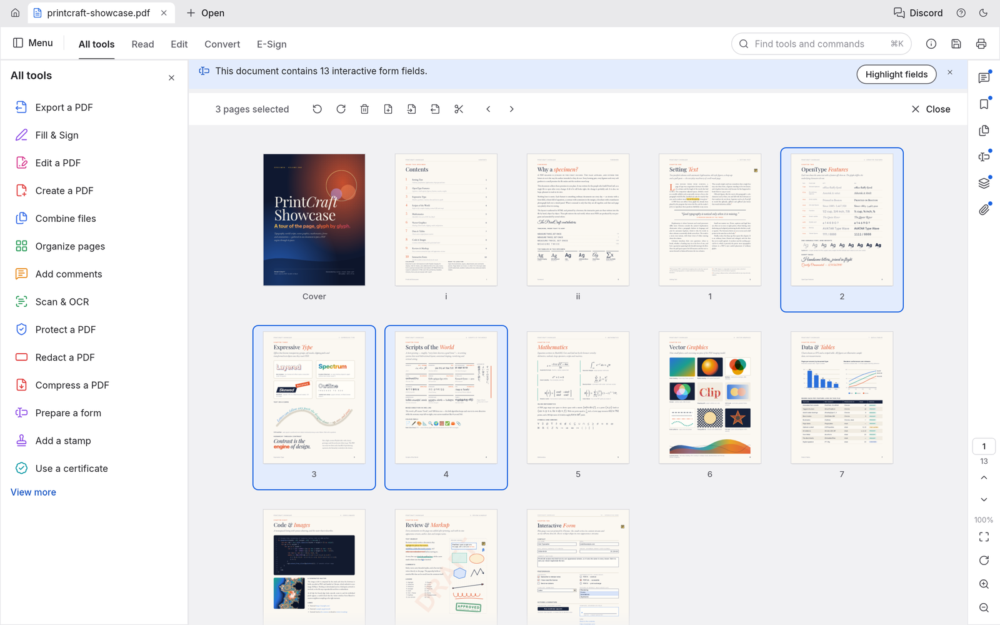
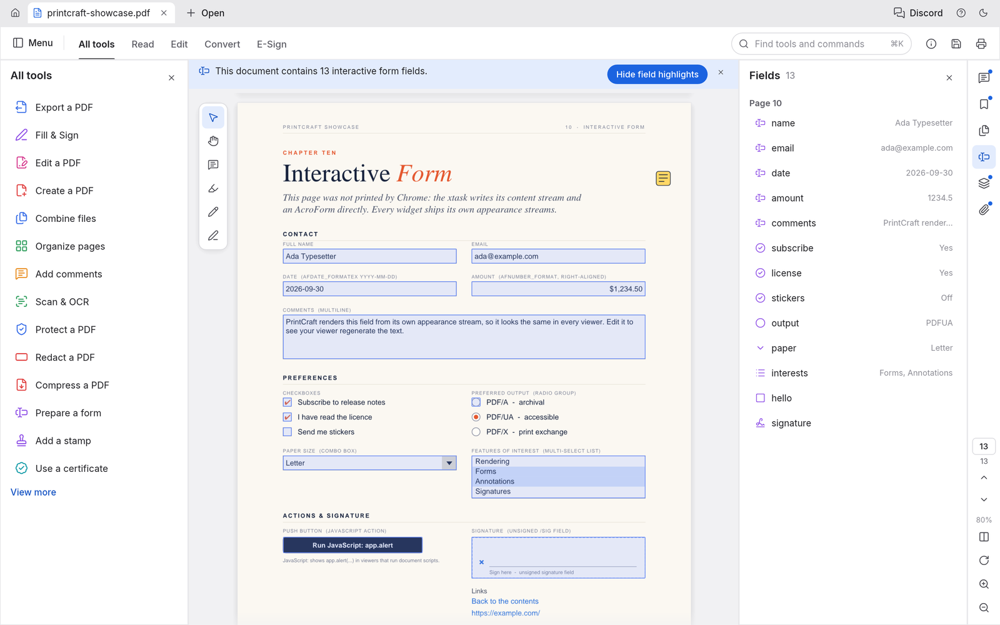
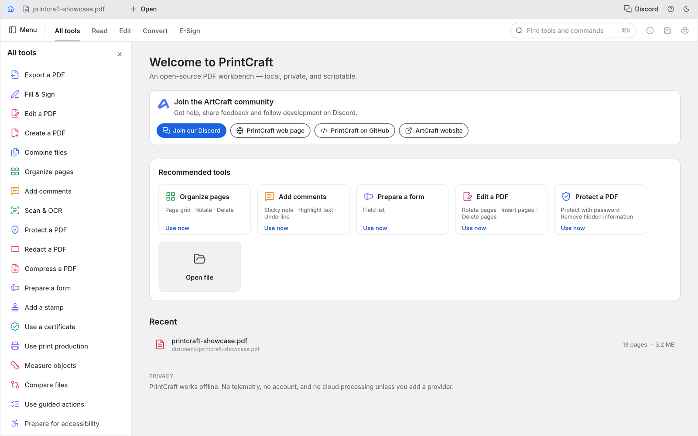

<p align="center">
  <a href="https://github.com/raantss18/mahay">
    <picture>
      <source media="(prefers-color-scheme: dark)" srcset="docs/brand/mahay-logo-white.svg">
      
    </picture>
  </a>
</p>


<h1 align="center">Taratasy</h1>

<p align="center">
  <b>The PDF workbench; an open-source, clean-room reimplementation of Adobe Acrobat, rebuilt in pure Rust.</b><br>
  Read, organize, combine, split and secure PDFs in a fast, native app, written in Rust from the ground up.<br>
  macOS · Windows · Linux · FreeBSD · the web
</p>

<p align="center">
  
  
  
  
</p>

<p align="center">
  <a href="https://github.com/raantss18/mahay/discussions"></a>
</p>

<p align="center">
  <a href="https://github.com/raantss18/mahay"><b>Taratasy in Mahay HUB</b></a> ·
  <a href="https://github.com/raantss18/mahay">Mahay</a> ·
  <a href="https://github.com/raantss18/mahay">All Mahay apps</a>
</p>

<br>

<p align="center">
  
  <br>
  <sub>The Taratasy Showcase, a 13-page specimen PDF, open with the All tools panel and threaded comments.</sub>
</p>

> [!NOTE]
> **Mahay is a community of artists from all walks of life.** Digital, generative, music,
> games &mdash; if you make things, you're one of us. **[Come say hi on Discord](https://github.com/raantss18/mahay/discussions).**

<p align="center">
  <a href="#highlights">Highlights</a> ·
  <a href="#read-anything-beautifully">Read</a> ·
  <a href="#find-it-select-it-copy-it">Find</a> ·
  <a href="#organize-pages-like-cards-on-a-table">Organize</a> ·
  <a href="#combine-and-split-without-losing-a-thing">Combine &amp; split</a> ·
  <a href="#open-protected-documents-and-respect-their-rules">Protect</a> ·
  <a href="#comments-forms-layers-and-attachments">Forms &amp; layers</a> ·
  <a href="#runs-everywhere-stays-yours">Everywhere</a> ·
  <a href="#built-for-agents-too">Agents</a> ·
  <a href="#how-its-built">How it's built</a> ·
  <a href="#get-started">Get started</a> ·
  <a href="#whats-next">What's next</a> ·
  <a href="#downloads">Downloads</a> ·
  <a href="#the-crafting-apps">Mahay apps</a>
</p>

---

## Community

Taratasy is part of [Mahay](https://github.com/raantss18/mahay). Come say hello, get help and follow development:

- **Discord: [github.com/raantss18/mahay/discussions](https://github.com/raantss18/mahay/discussions)**. This is the fastest way to get help and share feedback. The app has a Discord button in its title bar.
- **Web page:** [mahay.com/apps/taratasy](https://github.com/raantss18/mahay)
- **Source:** [github.com/raantss18/taratasy](https://github.com/raantss18/mahay)

The Mahay name and logos in `docs/brand/` are trademarks of the Mahay Team and are not open source. They may be used only unmodified, and only as part of Taratasy (see `docs/brand/LICENSE-brand.txt`). Forks and modified versions must remove them.

## Highlights

<table>
<tr>
<td width="33%" valign="top">

### Faithful
Real-world typography: world scripts, vertical Japanese, colour emoji, gradients, soft masks and transparency. All of it renders the way the author intended.

</td>
<td width="33%" valign="top">

### Fearless
Every save appends your changes and leaves the original bytes untouched. Writes are atomic, undo runs deep, and nothing is lost if you close by mistake.

</td>
<td width="33%" valign="top">

### Yours
No account, no telemetry, no cloud. It works offline and opens instantly. The engine, CLI and app are all open source.

</td>
</tr>
</table>

---

## Read anything, beautifully

Taratasy renders PDFs with care for the details that make a page feel right: kerning and ligatures, right-to-left and complex scripts, vertical CJK, colour emoji, shadings, blend modes, soft masks and optional content.

<p align="center">
  
  <br>
  <sub>Twelve writing systems on one page, plus vertical Japanese, at 125%.</sub>
</p>

- **Deep zoom stays sharp.** Large pages render in tiles, so text stays crisp at any magnification.
- **Built to survive bad files.** Every page renders in isolation and damaged documents are repaired. Across the 983-file pdf.js test corpus the result is 0 crashes.
- **Layouts for every task:** continuous, single page, two-up, view rotation, full screen and a distraction-free Read mode.
- **Light and dark themes**, both designed to be easy on the eyes for long sessions.

<table>
<tr>
<td width="50%"></td>
<td width="50%"></td>
</tr>
<tr>
<td align="center"><sub>Two-up Read mode, ready for long reading</sub></td>
<td align="center"><sub>The dark theme, with the comments panel open</sub></td>
</tr>
</table>

## Find it, select it, copy it

Search the whole document as you type, step through matches with <kbd>⌘G</kbd>, and select text that comes out in the right reading order. That holds for columns, right-to-left runs and CJK too.

## Navigate long documents

Right-click a PDF tab to close it, reopen the last closed file-backed tab, or reveal its file. Closing still asks about unsaved changes. Reopening reads the saved file from disk; it does not restore discarded edits. Reveal selects the file in Explorer or Finder. On Linux and FreeBSD it requests `org.freedesktop.FileManager1.ShowItems`, falling back to opening the containing directory with `xdg-open` when that service is unavailable. Reopen and Reveal are unavailable on the web; Reveal is also unavailable for pathless documents.

Bookmarks, page thumbnails and the document's own page labels (i, ii, 1, 2…) keep you oriented in long documents. Search bookmark titles in the Bookmarks panel to find nested entries even when their parents are collapsed. Matches keep their ancestors for context; Clear restores the unfiltered tree without changing its expansion state.

<table>
<tr>
<td width="50%"></td>
<td width="50%"></td>
</tr>
<tr>
<td align="center"><sub>Find as you type: match 10 of 16</sub></td>
<td align="center"><sub>Nested bookmarks with the document's own page labels</sub></td>
</tr>
</table>

---

## Organize pages like cards on a table

Open **Organize pages** to see every page at once:
- **Select pages:** click, <kbd>⌘</kbd>-click or <kbd>⇧</kbd>-click.
- **Change them:** rotate, delete, insert blank pages, insert pages from another file, and move them earlier or later.
- **Undo anything:** <kbd>⌘Z</kbd>, then save.

<p align="center">
  
  <br>
  <sub>Organize pages with three pages selected and the page tools in the toolbar above.</sub>
</p>

<table>
<tr>
<td width="50%" valign="top">

**Undo that goes the distance.** Each change is one step in a history you can walk backwards and forwards. The Edit menu names the step ("Undo Rotate pages"), and undo still works after you save.

**Saves you can trust:**
- *Incremental:* the original bytes stay byte-for-byte intact.
- *Atomic:* the file is written to a temporary copy, then swapped in.
- *Verified:* independently checked with qpdf, on every CI run.

When open documents exceed the window width, scroll over the tab strip with the mouse wheel or trackpad, or use its horizontal scrollbar. Opening or switching to a document brings its tab into view.

Unsaved documents carry a dot on their tab, and closing or quitting asks before anything is lost. Changes are autosaved every minute. If Taratasy ever quits unexpectedly, it offers to recover your work the next time it opens. Encrypted documents stay encrypted on disk.

</td>
<td width="50%" valign="top"><br><sub>Split document: one page per file makes 13 files.</sub></td>
</tr>
</table>

## Combine and split without losing a thing

**Combine files** merges any number of PDFs into one. Each file gets a bookmark, with its own bookmarks nested underneath.

**Extract** copies the pages you select into a new document. **Split** divides a document every *n* pages, or before the pages you choose.

Nothing quietly disappears along the way:
- links and named destinations are rewired to the copied pages;
- form fields stay interactive;
- layers keep their on/off defaults;
- attachments come along.

Every page of a combined document renders pixel-identical to its source.

```sh
taratasy-cli combine report.pdf appendix.pdf --out combined.pdf
taratasy-cli extract report.pdf --pages 1,3,5-8 --out highlights.pdf
taratasy-cli split   report.pdf --every 10 --out-dir parts/
```

---

## Open protected documents and respect their rules

Taratasy implements the PDF standard security handler completely:
- every revision, from 40-bit RC4 to AES-256;
- user and owner passwords, including Unicode passwords normalised with SASLprep;
- crypt filters and attachment-only encryption.

Documents restricted by their author show a clear notice, and Taratasy honours their permissions. Enter the owner password and the restrictions lift. Edits to encrypted documents are saved encrypted, under the same keys.

<table>
<tr>
<td width="50%" valign="top"><br><sub>Document Properties, Description tab</sub></td>
<td width="50%" valign="top">

**Document Properties** shows:
- the document's title, author, subject and keywords, which you can edit;
- the fonts it uses and whether each is embedded;
- PDF version, page size, tags, fields, layers and attachments;
- the full security picture: encryption method, which password opened it, and each permission.

</td>
</tr>
</table>

## Comments, forms, layers and attachments

<table>
<tr>
<td width="50%"></td>
<td width="50%"></td>
</tr>
<tr>
<td valign="top"><b>Forms</b>: every field with its current value, field highlighting, and checkboxes, radio buttons, lists and signatures drawn the way their author designed them.</td>
<td valign="top"><b>Layers</b>: switch optional content on and off and the page re-renders instantly. <b>Comments</b> appear as threaded conversations, and <b>attachments</b> can be opened or saved.</td>
</tr>
</table>

## Every tool, one keystroke away

Press <kbd>⌘K</kbd> to search every tool and command, or browse the **All tools** catalogue. Tools that are still in development are marked with the milestone that will ship them.

<table>
<tr>
<td width="50%"></td>
<td width="50%"></td>
</tr>
<tr>
<td align="center"><sub>The <kbd>⌘K</kbd> command palette</sub></td>
<td align="center"><sub>The home screen and the All tools catalogue</sub></td>
</tr>
</table>

---

## Runs everywhere, stays yours

- **Native on macOS, Windows, Linux and FreeBSD**, and **in the browser** through WebAssembly, from the same Rust codebase. Windows builds come for x64, x86 and ARM64 (Windows on ARM, no emulation); every ARM64 change is tested on ARM64 hardware in CI.
- **Private by design.** Documents never leave your machine. There's no account, no telemetry and no cloud processing.
- **Engine first.** Parsing, rendering and editing live in reusable library crates. The interface is one swappable layer on top.
- **Scriptable.** The `taratasy-cli` tool (see [Built for agents, too](#built-for-agents-too)) covers inspecting, rendering, extracting text, editing, combining, extracting pages and splitting. Robustness sweeps run on the same engine as the app.

```sh
taratasy-cli info  form.pdf                                  # structure as JSON
taratasy-cli text  paper.pdf --page 3                        # reading-order text
taratasy-cli edit  in.pdf --rotate 1,2:90 --delete 5 --title "Q3" --out out.pdf
```

---

## Built for agents, too

Every engine feature is reachable without the GUI, through one table of JSON-Schema-described tools: open, inspect, render pages to PNG, extract and find text, rotate, delete, move and insert pages, edit bookmarks and page labels, add, reply to, restyle and delete comments (highlight a phrase just by naming it), list and fill in form fields, protect with passwords, set metadata, undo and redo, save, combine, extract and split. Three front doors share it:

- **`taratasy-cli run`**, for one-off calls and JSON scripts:

  ```sh
  taratasy-cli tools                                        # every tool and its JSON Schema
  taratasy-cli run text_find doc=1 query=invoice            # key=value; values parse as JSON
  taratasy-cli run --script review.json                     # e.g. comment_add {"type": "highlight", "find": "total due"}
  taratasy-cli run --script steps.json --root ./work        # several steps in one session
  taratasy-cli run --script steps.json --report             # one JSON document: per step its number, tool, status, result or error
  ```

  With `--root`, every file the script's steps read or write stays in that directory, including the PNG a step saves with `"out"` (the script itself is read from wherever you name it).

- **An MCP server**, for AI agents such as Claude. **It is opt-in:** Taratasy never starts it on its own, and it opens no network port. It runs only while an agent launches `taratasy-cli mcp`, talks over stdin/stdout, and stops when the agent disconnects. To enable it, add it to your agent's MCP configuration:

  ```json
  { "mcpServers": { "taratasy": { "command": "taratasy-cli", "args": ["mcp", "--root", "/path/to/your/pdfs"] } } }
  ```

  `--compact` shrinks the tool list the agent has to read: `tools/list` returns about ten core tools plus `tool_search` and `tool_call`, which find and run every other tool, so the list costs far fewer tokens. Every tool still works.

  `--root` confines every file the agent can read or write to one directory. Builds that should not include the server at all can use `cargo build -p taratasy-cli --no-default-features`.

- **The Rust API** (`taratasy_automation::Automation::call`), for embedding.

Edits stay in memory, undoable, until `doc_save`. Saving to the same file appends an incremental update, so the original bytes are preserved, and the write is atomic. Unsaved changes are never discarded silently.

### Driving the app itself

Start the desktop app with `taratasy --control ~/.taratasy-control.json` and an agent can see and operate the real interface: the widget tree with labels and positions (from the accessibility tree), clicks, typing, keys, commands, view options and screenshots. This is also off by default. It listens only on loopback, and every connection must present the random token written to that file, which only you can read.

Keep the control file in a folder only you can write, not a shared one such as `/tmp`: another user could create the file there first and receive your commands. `taratasy-cli ui` refuses a control file that is a symbolic link, and on macOS, Linux and FreeBSD one that another user owns or can read or write. The app doesn't start if it can't write the file.

```sh
taratasy-cli ui --control ~/.taratasy-control.json inspect query=rotate      # find widgets
taratasy-cli ui --control ~/.taratasy-control.json click label="Organize pages"
taratasy-cli ui --control ~/.taratasy-control.json key key=K modifiers='["command"]'
taratasy-cli ui --control ~/.taratasy-control.json command id=comment.square   # pick a tool, then draw:
taratasy-cli ui --control ~/.taratasy-control.json drag from='[400,300]' to='[600,420]'
taratasy-cli ui --control ~/.taratasy-control.json screenshot --out window.png
taratasy-cli ui --control ~/.taratasy-control.json resize width=1200 height=800
taratasy-cli ui --control ~/.taratasy-control.json focus label="Read"
taratasy-cli ui --control ~/.taratasy-control.json inspect focused=true
taratasy-cli ui --control ~/.taratasy-control.json quit
```

`ui.dock` arranges the `tools` and `inspector` panels; `canvas` is the protected document view.
Each per-panel request requires a `panel` ID and an `operation`: `open`, `close`,
`activate`, `float` with `rect: [x, y, width, height]`, or `move` with `target` and
`zone: center|left|right|top|bottom`. For example,
`{"operation":"float","panel":"tools","rect":[100,100,320,440]}` floats Tools.
`ui.dock.reset` restores the default
arrangement. The control channel accepts these methods directly; `ui.command` also accepts
`{"id":"ui.dock","params":{...}}`. Saved preferences retain groups, active tabs, visibility
and floating geometry. Invalid requests return an error without changing the document or layout.


`resize` requests a native inner-window size in logical points (each dimension must be between 320 and 8192); the window manager may constrain it. `state` reports the observed `window.width`, `window.height` and `window.pixels_per_point`. `focus` accepts exactly one widget `id` or unique enabled, focusable `label`; subsequent `key` requests traverse or activate the actual widgets. `inspect` includes focusability and accepts a `focused` filter. `quit` takes no parameters: clean documents exit normally, while unsaved edits or typing open the existing Save/Don't save/Cancel prompt and return `quitting: false, needs_confirmation: true`. It never silently discards work. Window resizing and application quit are native-only.

---

## How it's built

Taratasy is a Cargo workspace of focused crates, layered so the core never depends on the UI:

| Crate | What it does |
|---|---|
| `taratasy-filters` | Every PDF stream filter (Flate, LZW, ASCII85, RunLength, predictors), encode and decode, property-tested |
| `taratasy-crypt` | The standard security handler: RC4, AES-128/256, revisions 2–6, permissions |
| `taratasy-cos` | The PDF object layer: tolerant parsing, repair, copy-on-write edits, incremental and full writing |
| `taratasy-organize` | Page operations, combine / extract / split, bookmarks, page labels, document information |
| `taratasy-fonts` | Font metrics and encodings for generated appearances |
| `taratasy-annot` | Comments: builders and appearance streams for notes, text markup, shapes, ink and text boxes; replies, status, edits |
| `taratasy-forms` | Interactive forms: the field model, filling with regenerated appearances, Clear form |
| `taratasy-render` | Rendering, inspection and text extraction with reading order |
| `taratasy-engine` | The façade every frontend uses: sessions, edits, undo, saving, the tool catalogue |
| `taratasy-automation` | Agent control: the headless tool table, `taratasy-cli run`, and the opt-in MCP server |
| `taratasy-ui-egui` | The desktop and web interface |

**Quality gates.** Every change passes the same automated checks:
- formatting, and Clippy with warnings as errors;
- 200+ unit, property and UI tests;
- crate-layering rules and a WebAssembly build check;
- an asset-licence audit.

On top of those, two corpus sweeps run over real-world files:
- **Opening and rendering:** of the 983 pdf.js test files, 963 open and render cleanly, with 0 crashes.
- **Open, edit and save round trips:** 958 succeed.

The output is verified against independent implementations: hayro and qpdf on every CI run, and
poppler over the corpus on demand (`cargo xtask text-oracle`).

Taratasy is a clean-room implementation. Its behaviour comes from the ISO 32000 specification and black-box observation, never from anyone else's code. Every icon, font and image is openly licensed and listed in [ATTRIBUTION.md](ATTRIBUTION.md).

## Get started

Building needs Rust 1.95 or later.

```sh
git clone https://github.com/raantss18/mahay
cd taratasy
cargo xtask models                                # fetch the OCR models Scan & OCR needs (release builds include them)
cargo run --release -p taratasy -- some.pdf     # desktop app
cargo xtask demo-pdf                              # build the showcase PDF used in these screenshots
cargo xtask screenshots                           # regenerate every screenshot in this README
```

The interface language is chosen in **Menu → Edit → Preferences…** (Command-comma on macOS,
Ctrl-comma elsewhere, also with no document open; Auto follows the system language;
see [docs/localization.md](docs/localization.md)) and saved. Japanese covers commands,
dialogs, panels and keyboard shortcuts. Command search accepts the translated label, the
English label and the stable command id; filenames, PDF contents, author names, custom
action names and error details from the engine or the operating system keep their own text.

Japanese fonts come from [mahay-fonts](https://github.com/raantss18/mahay), an optional build
input that every release includes. To build with them (Japanese interface text, and Japanese text in
edited PDFs):

```sh
git clone https://github.com/raantss18/mahay ../mahay-fonts
MAHAY_FONTS_DIR=../mahay-fonts cargo run --release -p taratasy -- some.pdf
```

Each [GitHub release](https://github.com/raantss18/mahay/releases) has ready-made builds for macOS,
Windows, Linux (AppImage, Flatpak, `.deb`, `.rpm` and a tarball), FreeBSD and the web; see
[Downloads](#downloads). On Gentoo, the community [::snakebyte
overlay](https://github.com/switch87/snakebyte-overlay) packages the Linux release as
`app-text/taratasy-bin` (not maintained by the Taratasy team):

```sh
eselect repository add snakebyte git https://github.com/switch87/snakebyte-overlay.git
emaint sync -r snakebyte
echo 'app-text/taratasy-bin ~amd64' >> /etc/portage/package.accept_keywords/taratasy
emerge --ask app-text/taratasy-bin
```

Logs, environment variables and other development notes are in [docs/development.md](docs/development.md).

## What's next

Taratasy is young and moving fast. The aim is a workbench where you can view, organize, annotate, fill, sign and edit PDFs, at parity with Acrobat Pro.

**Where it stands (October 2026), honestly:** Taratasy is **alpha**. Most of Acrobat Pro's offline features exist in some form (57% of all tracked features, 94% of the must-haves). For everyday work (viewing, commenting, filling and signing forms, organizing pages) it is about 55% of the way to replacing Acrobat; against all of Acrobat Pro, about 49%; for someone who only needs the essentials, about 66%. Every everyday workflow can be completed, but converting and sharing is weak: no Office-to-PDF, and Word export that loses layout.

- **Good today:** viewing and search; organizing, combining and splitting; most kinds of comment; filling and authoring forms (with sandboxed JavaScript); passwords, redaction and sanitizing; basic digital signatures; printing; the Accessibility Checker; agent control through the CLI and MCP.
- **Still borrowed:** pages are drawn by the `hayro` crate while our own renderer is built.
- **Thin or missing:** reliable editing of existing text (especially CJK and right-to-left), OCR beyond Latin script, Office import/export, signature tokens and online long-term validation, Preflight and PDF/X/UA, printing from the web build, physical printer fidelity, and full XFA forms.
- **Hardening:** fuzzing still turns up crashes and hangs on hostile files; each one is fixed with a regression test. Quality has not yet been compared with Acrobat side by side.

**Next, in order:** Office-to-PDF and a Word export that keeps layout, the reported bugs and the Chinese interface font, a fidelity harness against Acrobat and the renderer, editing existing content, then the Pro workflows (OCR, Office, Preflight, signatures, accessibility tagging) and 1.0 polish.

The summary is in **[ROADMAP.md](ROADMAP.md)**; the full assessment by dimension and area is in [docs/target-app-parity.md](docs/target-app-parity.md), the ranked gaps in [docs/gaps.md](docs/gaps.md), and the milestones in [docs/roadmap.md](docs/roadmap.md).

---

## Downloads

**New to Taratasy?** Download it from the [Taratasy page in Mahay HUB](https://github.com/raantss18/mahay). That's the easiest way to install it.

**Want a specific build or format?** On GitHub, the [latest release](https://github.com/raantss18/mahay/releases/latest) has every build listed below, and [all releases](https://github.com/raantss18/mahay/releases) has earlier versions and their notes. `<ver>` in the file names is the version number, and `SHA256SUMS.txt` lists a checksum for every file.

### Windows

| Build | Installer | Portable |
|---|---|---|
| x64 (64-bit Intel/AMD) | `taratasy-<ver>-windows-x64.msi` | `taratasy-<ver>-windows-x64-portable.zip` |
| arm64 (Snapdragon and other ARM PCs) | `taratasy-<ver>-windows-arm64.msi` | `taratasy-<ver>-windows-arm64-portable.zip` |
| x86 (32-bit) | `taratasy-<ver>-windows-x86.msi` | `taratasy-<ver>-windows-x86-portable.zip` |

Installers and executables are code-signed.

The portable zip runs from any folder, a USB stick included. Its `portable.txt` keeps the settings,
logs and crash recovery in a `TaratasyData` folder next to `taratasy.exe`, so nothing is written to
`%APPDATA%`; delete that file to use the normal per-user folders.

The MSI installs for all users and requires administrator privileges. It adds "Edit with Taratasy"
to the right-click menu of PDF files and "Create PDF with Taratasy…" to the right-click menu of
images (.png .jpg .jpeg .tif .tiff .gif .bmp .jp2 .j2k .jpx) in File Explorer (on Windows 11, under
"Show more options"), without changing which app opens them by default. For unattended deployment
without a desktop shortcut, run from an elevated terminal:

```powershell
msiexec /i "taratasy-<ver>-windows-x64.msi" /qn /norestart INSTALLDESKTOPSHORTCUT=0
```

| Property | `=0` leaves out |
|---|---|
| `INSTALLDESKTOPSHORTCUT` | the all-users desktop shortcut |
| `INSTALLPDFCONTEXTMENU` | "Edit with Taratasy" on PDF files |
| `INSTALLIMAGECONTEXTMENU` | "Create PDF with Taratasy…" on images |

All three are on for a first install. An upgrade keeps what the installed version has: a shortcut
or menu entry that is there stays, and one that is missing (left out at install, or a desktop
shortcut someone deleted) stays missing, so you don't need to pass them again. A value on the
command line always wins: `=1` puts one back and `=0` removes it. Upgrading from a release that
didn't have a menu yet (0.6.0 and earlier for the PDF menu, 0.2.1 and earlier for the image menu)
adds it, as a first install would. Use the MSI for your architecture. Per-user installation
overrides are not supported.

**Pin the checksum, not just the version.** Release candidates of a version share its MSI version
(MSI versions are numbers only, so 1.2.3-rc.1 and 1.2.3 are both 1.2.3), and the installer lets an
MSI of the same version replace the installed one without asking. Two different `0.7.1` MSIs can't
be told apart by version, so if your deployment tool checks the file, pin its SHA-256 from
`SHA256SUMS.txt` (`Get-FileHash <file> -Algorithm SHA256`).

**Signing identities.** The Windows MSIs and both executables are signed through Azure Trusted
Signing with a certificate issued to `Learning Machines Inc` (Atlanta, Georgia, US). The macOS app
and command-line tool are signed with the Developer ID `Learning Machines LLC (DJ6XS33FX8)` and
notarized. The MSI's manufacturer, shown as the publisher in Installed apps, is
`Learning Machines LLC`.

### macOS

| Build | File | Notes |
|---|---|---|
| App, universal (Apple silicon + Intel) | `taratasy-<ver>-macos-universal.dmg` | Signed and notarized |
| Command-line tool, universal | `taratasy-cli-<ver>-macos-universal.zip` | Signed and notarized |

### Linux

| Format | x86_64 | aarch64 (ARM64) | Notes |
|---|---|---|---|
| AppImage | `taratasy-<ver>-linux-x86_64.AppImage` | `taratasy-<ver>-linux-aarch64.AppImage` | Runs anywhere; updates itself with [AppImageUpdate](https://github.com/AppImageCommunity/AppImageUpdate) (`.zsync` files) |
| Flatpak | `taratasy-<ver>-linux-x86_64.flatpak` | `taratasy-<ver>-linux-aarch64.flatpak` | Sandboxed; `flatpak install --user <file>` |
| Debian/Ubuntu | `taratasy-<ver>-linux-x86_64.deb` | `taratasy-<ver>-linux-aarch64.deb` | |
| Fedora/RHEL/openSUSE | `taratasy-<ver>-linux-x86_64.rpm` | `taratasy-<ver>-linux-aarch64.rpm` | |
| Tarball | `taratasy-<ver>-linux-x86_64.tar.gz` | `taratasy-<ver>-linux-aarch64.tar.gz` | Unpack anywhere |
| Command-line tool | `taratasy-cli-<ver>-linux-x86_64.tar.gz` | `taratasy-cli-<ver>-linux-aarch64.tar.gz` | `taratasy-cli` alone (and its opt-in MCP server), for servers, CI and agents |

RISC-V (riscv64) builds come as tarballs only: `taratasy-<ver>-linux-riscv64.tar.gz` and `taratasy-cli-<ver>-linux-riscv64.tar.gz`. They are cross-compiled and need glibc 2.39 or newer (Ubuntu 24.04+, Debian 13+).

Every other Linux build needs glibc 2.35 or newer (Ubuntu 22.04+, Debian 12+, Fedora 36+, RHEL 10).

### FreeBSD

| Build | File |
|---|---|
| x86_64 | `taratasy-<ver>-freebsd-x86_64.tar.gz` |

### Web (WebAssembly)

| Build | File | Notes |
|---|---|---|
| Static site | `taratasy-web-<ver>.zip` | Runs in a modern browser; host it on any static server |

---

## The Mahay apps

Taratasy is one of the **Mahay apps**: free, open-source creative tools from the
[Mahay](https://github.com/raantss18/mahay) team, each written from scratch in Rust and each able to
stand on its own.

| | App | What it's for | Code | Learn more |
|:-:|---|---|---|---|
|  | **Sary** | Image editing: layers, masks, type and real PSD files | [GitHub](https://github.com/raantss18/mahay) | [Website](https://github.com/raantss18/mahay) |
|  | **Tsilo** | Vector illustration | [GitHub](https://github.com/raantss18/mahay) | [Website](https://github.com/raantss18/mahay) |
|  | **Hetsika** | Video editing, color and sound | [GitHub](https://github.com/raantss18/mahay) | [Website](https://github.com/raantss18/mahay) |
|  | **Hazavana** | Photo library and raw development | [GitHub](https://github.com/raantss18/mahay) | [Website](https://github.com/raantss18/mahay) |
|  | **Taratasy** | **Reading, organizing and protecting PDFs · you are here** | [GitHub](https://github.com/raantss18/mahay) | [Website](https://github.com/raantss18/mahay) |
|  | **Tselatra** | Motion graphics and visual effects | [GitHub](https://github.com/raantss18/mahay) | [Website](https://github.com/raantss18/mahay) |
|  | **Pejy** | Page layout and publishing | [GitHub](https://github.com/raantss18/mahay) | [Website](https://github.com/raantss18/mahay) |

And [**Mahay**](https://github.com/raantss18/mahay) itself, our AI image and video studio for artists who want real control.

<br>

<p align="center">
  <a href="https://github.com/raantss18/mahay/discussions"></a>
</p>

<h3 align="center">Come make things with us</h3>

<p align="center">
  Our Discord is where artists of every kind hang out: people who paint, shoot, draw, cut film,
  set type, and people still figuring out what they like to make. Share what you're working on,
  ask for help, tell us what's broken, or tell us what you wish these tools could do.
  Whatever your medium and however long you've been at it, you're welcome here.
</p>

<p align="center">
  <a href="https://github.com/raantss18/mahay/discussions"><b>github.com/raantss18/mahay/discussions</b></a> ·
  <a href="https://github.com/raantss18/mahay">Mahay HUB</a> ·
  <a href="https://github.com/raantss18/mahay">The Mahay apps</a> ·
  <a href="https://github.com/raantss18/mahay">Taratasy</a>
</p>

---

## License and credits

Taratasy is dual-licensed under [MIT](LICENSE-MIT) or [Apache-2.0](LICENSE-APACHE), at your option.
Copyright (c) 2026 Mahay Team and the Taratasy contributors. Required notices are in [NOTICE](NOTICE).

Bundled fonts, icons, images and other assets keep their own open licenses; each one is listed
with its author, source and license in [ATTRIBUTION.md](ATTRIBUTION.md). Release builds also embed
the Japanese fonts of [mahay-fonts](https://github.com/raantss18/mahay/blob/main/ATTRIBUTION.md)
(SIL Open Font License 1.1).

The Mahay name, wordmark and logos in [`docs/brand/`](docs/brand/) are trademarks of the
Mahay Team and are not covered by this license. They may be used only unmodified, and only as
part of this repository and Taratasy, under [`docs/brand/LICENSE-brand.txt`](docs/brand/LICENSE-brand.txt).
Forks and modified versions must remove them.

<sub>Adobe, Photoshop, Illustrator, Premiere Pro, Lightroom, Acrobat, After Effects and InDesign are trademarks or registered trademarks of Adobe Inc. in the United States and/or other countries. Taratasy is an independent, open-source project and is not affiliated with, sponsored by or endorsed by Adobe Inc.; these names are used only to describe the workflows it is compatible with.</sub>

<p align="center">
  <a href="https://github.com/raantss18/mahay"></a><br>
  <sub>Made by the <a href="https://github.com/raantss18/mahay">Mahay</a> team and community.</sub>
</p>

Tools and Inspector panels can be dragged into tab groups, split beside the PDF, or floated within the app window. Read and full-screen modes keep their existing focused document view. Drag a panel header to a target edge or another header. Its context menu offers Float panel, Move to group, and Close panel. Existing panel toggles reopen panels at their saved location; Reset Panel Layout restores the app layout. Floating panels remain inside the current app window.

Advanced `ui.dock` operations use the same validated transaction as pointer gestures:
`moveFloating` updates `rect`, `resizeSplit` accepts a boolean child `path` and
`size` (`{"Ratio":0.5}`, `{"FixedFirst":280}`, or `{"FixedSecond":280}`),
`setStackOpen` takes `open`, and `resizeStack` takes a point `height` or null.
A center `move` can include `before` (panel ID or null to append) for tab order.
The equivalent `{"action": ...}` form accepts a serialized shared docking action;
this is also the form emitted by the renderer. Protected-canvas and app-specific panel
rules apply equally to both forms.
